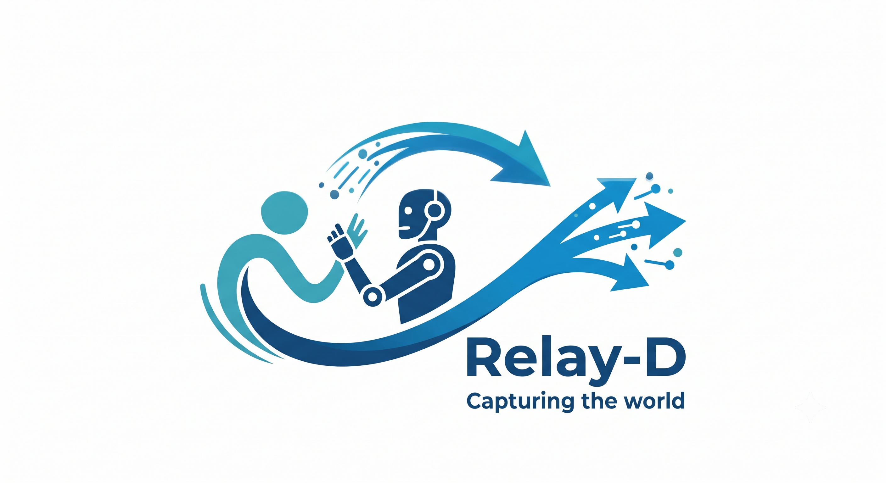

[](LICENSE)

# Relay-D

**Description:** Relay-D is a standalone application for recording synchronized data from multi-modal sensor robotic systems built on ROS 2, and for running the trained policies back on the robot. It streamlines the entire Learning-from-Demonstration (LfD) training loop by facilitating three core tasks: recording robot sensor data, converting it into imitation-learning training datasets, and deploying the trained policy back onto the robot.

- **What it does** — records robot sensor topics and TF to HDF5 per a YAML config, converts recordings into [Robomimic](https://robomimic.github.io/) or [LeRobotDataset v3.0](https://huggingface.co/docs/lerobot/main/en/lerobot-dataset-v3) training datasets, and runs a trained LfD policy live on the robot (subscribing to sensor data, running a forward pass, and dispatching the resulting action).
- **Who it is for** — robotics researchers and engineers building imitation-learning pipelines on ROS 2 (Jazzy) robots.
- **The problem it solves** — LfD projects usually stitch together bespoke, one-off scripts for recording, format conversion, and inference. Relay-D replaces that with a single, consistent tool covering the whole loop, so datasets recorded for training are guaranteed to be compatible with the config format consumed at inference time.

**Screenshot:**

<!-- TODO: add a screenshot of the RelayDApp GUI (e.g. the Record page with live sensor feeds) here. -->

---

## 1. Project status

This project is currently **in progress**: it is actively being developed and core functionality (recording, conversion, and inference) is working end-to-end, but features and structure may still change.

---

## 2. Technology stack

- **Language:** Python ≥ 3.12
- **Frameworks and libraries:** ROS 2 Jazzy (`rclpy`, `tf2_ros`), PyQt5 (`RelayDApp` GUI), PyTorch (installed with robomimic / LeRobot), [Robomimic](https://robomimic.github.io/) (optional, imitation-learning backend), OpenCV, h5py
- **Other tools:** pip/setuptools packaging, GitHub Actions (CI)

Relay-D is a plain pip package (not a colcon/ament package) intended to run standalone inside a Python environment where ROS 2 Jazzy has already been sourced — it is not a ROS 2 node package in its own right, but it depends on a sourced ROS 2 environment at runtime.

It is composed of two subsystems that interoperate directly:

- **`relay_d.acquisition`** — the `RelayDApp` GUI: records robot sensor data (topics + TF) to HDF5 per a YAML config, and converts recordings to Robomimic format. Also exposes a headless `AppAPI` for programmatic recording that runs the same code as the GUI (same config checks, same start/stop, same conversion and files).
- **`relay_d.dispatch`** — the `lfd-inference-node` CLI: runs a trained LfD policy live on the robot. Also exposes a programmatic `InferenceSession` API.
- **`relay_d.utils`** — small utilities shared by both subsystems (currently the colored console logger).

See [Architecture diagrams](#6-architecture-diagrams) for how these pieces fit together.

---

## 3. Dependencies

### Python (pip-installable, declared in `pyproject.toml`)

| Package | Used for |
|---|---|
| `numpy` | array/data handling (NumPy 1.x and 2.x both supported) |
| `pyyaml` | YAML config parsing |
| `h5py` | HDF5 recording/dataset I/O |
| `opencv-python-headless` | image processing (no GUI/X11 dependency — PyQt5 supplies the GUI) |
| `pyqt5` | `RelayDApp` GUI toolkit |
| `pyqtgraph` | live plotting widgets in the GUI's review page |

**Optional extra** — `pip install ".[robomimic]"`:

| Package | Used for |
|---|---|
| `robomimic` (`>=0.4`) | imitation-learning policy backend. **Must** be installed from an [ARISE-Initiative](https://github.com/ARISE-Initiative/robomimic) source checkout, not plain PyPI (see [Installation](#4-installation)) |

**For `lfd-inference-node` / `InferenceSession`** there is no extra: policies run with the package that trained them, installed
in the Python that runs the node: `robomimic` (above) for `.pth` checkpoints, or `lerobot` (`pip install 'lerobot[training]'`,
plus `'lerobot[diffusion]'` for Diffusion and `'lerobot[smolvla]'` for SmolVLA) for LeRobot checkpoints. See "Running inference on the robot".

**Optional extra** — `pip install ".[lerobot]"` (only needed to convert recordings to the [LeRobotDataset](https://huggingface.co/docs/lerobot/main/en/lerobot-dataset-v3) format):

| Package | Used for |
|---|---|
| `pyarrow` | writing the LeRobot parquet data and metadata files |
| `av` (PyAV) | encoding camera streams to mp4. Only needed when the recording contains camera images |

**Dev-only** — `pip install --group dev .` / `[dependency-groups] dev`:

| Package | Used for |
|---|---|
| `pytest` | ROS-free test suite (`pytest` from the repo root) |

### System / ROS 2 (not pip-installable)

These must come from a sourced ROS 2 Jazzy environment (see [Installation](#4-installation)) rather than `pip`:

| Package | Used for |
|---|---|
| `rclpy` | ROS 2 Python client library — nodes, topics, actions |
| `tf2_ros`, `tf2_msgs` | transform lookups |
| `geometry_msgs`, `std_msgs`, `sensor_msgs`, `sensor_msgs_py`, `trajectory_msgs`, `builtin_interfaces` | ROS 2 message types |
| `rosidl_runtime_py` | introspecting ROS 2 message/service definitions |
| `xacro` | resolving robot description macros (used by `scripts/extract_joint_limits.py`, which prints URDF joint limits for the `limits:` clamp of an `action_config.yaml` entry, in real units) |

### Other system libraries

- **Qt5** shared libraries (via `PyQt5`) — required at runtime for the `RelayDApp` GUI.
- **libhdf5** (via `h5py`) — usually pulled in automatically by the `h5py` wheel; only relevant if building `h5py` from source.

Keep dependencies up to date to avoid security vulnerabilities and compatibility issues (see `pyproject.toml` and `CHANGELOG.md` for the currently pinned versions).

---

## 4. Installation

```bash
# 1. Source ROS 2
source /opt/ros/jazzy/setup.bash
sudo apt install ros-jazzy-tf2-ros ros-jazzy-geometry-msgs ros-jazzy-std-msgs \
    ros-jazzy-sensor-msgs ros-jazzy-image-transport

# 2. Clone
cd ~/ros2_ws/src
git clone git@github.com:pascd/Relay-D.git
cd Relay-D

# 3. Install
pip install -e .

# Optional: robomimic, to run robomimic policies (`lfd-inference-node --backend robomimic`).
# IMPORTANT: PyPI's `robomimic` package only goes up to 0.3.0 and is NOT
# compatible with checkpoints trained from a newer ARISE-Initiative source
# checkout (this dispatcher targets >=0.4, e.g. 0.5.0). Install your
# robomimic source checkout in editable mode FIRST, then install this
# extra — do NOT rely on `pip install robomimic` alone.
# Version from source and pip may differ when training models
pip install -e /path/to/your/robomimic/checkout   # e.g. your ARISE-Initiative source clone
pip install -e ".[robomimic]"

# Verify afterward that the correct version/source is active:
python -c "import robomimic; print(robomimic.__version__, robomimic.__file__)"
# Expect your checkout's version and a path under your local checkout,
# NOT a site-packages/robomimic path installed from PyPI.
```

This is a plain pip package (not a colcon/ament package) — no `colcon build` step is required. It just needs to run inside a Python environment where ROS 2 has already been sourced.

---

## 5. Usage

### Recording data (RelayDApp)

```bash
RelayDApp
```

Three pages: **Config** (load/validate your YAML), **Record** (start/stop, live sensor feeds), **Post-process** (convert raw recordings to Robomimic or LeRobot format; a config can be loaded here without the robot running).

Everything lands in the recordings folder (Settings), named by what it holds:

```
<recordings folder>/
  2026-11-02_15-00-00_Recording/     the demos of one recording session (*.h5)
  2026-11-02_15-10-00_Robomimic/     dataset_<time>_Robomimic.h5, its configs and action_dispatcher/
  2026-11-02_15-12-00_Lerobot/       dataset_<time>_Lerobot/ (the LeRobot dataset folder), configs and action_dispatcher/
```

### Building the acquisition config from the running robot

On the **Config** page, the **Build from ROS** tab writes `acquisition_config.yaml` for you (start your robot's drivers first):

1. **Sources**: topics of the live graph (filter, double-click to add; or type a topic the graph does not show yet) and TF frames (a parent and a child, any connected pair).
2. **Inputs**: output group, modality (`depth`, `scan`), `joint_names` (**Read joint names from the topic** takes them from one live message), gap filling. The first word of an input name (`image_`, `joint_`, `pose_`, `tf_`, ...) picks its live view on the Record page, and is suggested for you.
3. **Observations**: tick message fields to fill the specs of a stream (`joint_1.position[:]`, `tf_eef.translation.x`; edit the text for arithmetic, `sin()/cos()` or a single element), roll/pitch/yaw for quaternions. Values stay in real units: robomimic and LeRobot normalize with the dataset's stats. Images and point clouds are added as camera observations.
4. **Actions**: tick the streams that form the action, in order, with optional delta.  5. **Recording**: name, frequency, buffer, sync.
6. **Review**: the YAML, the problems found (errors block saving) and **Save and use now**, which loads it like any hand-written file. **Edit loaded config** brings an existing file back into the builder.

The headless `AppAPI`, `relay-d-convert` and the other tools still take a ready-made config file. The train / validation split and the LeRobot options (task, robot type, video settings) stay in `postprocess_config.yaml`; the robomimic policy is chosen on the Train tab.

### Converting recordings without the GUI

```bash
# LeRobotDataset v3.0 (needs: pip install ".[lerobot]")
relay-d-convert --config acquisition_config.yaml --format lerobot \
    --input recordings/ --output my_lerobot_dataset

# Robomimic HDF5
relay-d-convert --config acquisition_config.yaml --format robomimic \
    --input recordings/ --output out/dataset.h5
```

No ROS or display is needed. `--input` takes `.h5` files and/or directories (searched recursively).
Format options (train / validation split, LeRobot task, ...) are read from
`--options` or a `postprocess_config.yaml` next to the config; see
`relay_d/acquisition/qt_app/ui/config/templates/postprocess_config_template.yaml`. A broken options file stops the conversion (CLI, `AppAPI`
and the Post-process page alike), and all three write the same dataset and the same files next to it.
`relay-d-convert --check` (no `--output` needed) and the Post-process page run the same pre-check before anything is written: for each
demo its sample count, recorded rate, the config it was recorded with, and whether it converts or why not; and the layout that will be
written (robomimic keys and shapes, action columns, masks; LeRobot features, fps, task). A configured stream that is in none of the
selected recordings stops the conversion and names the streams the recordings do have and the config they were recorded with; a demo
recorded with another config or `recording_frequency` is skipped with that config named. The page adds recordings by file or by folder
(recursive, like `--input`), drops selected ones with **Remove selected** or the Delete key (nothing is deleted from disk), and its Convert button says how many demos will be converted.

### Running inference on the robot

Two policy backends, picked from the checkpoint (`--backend auto`, the default) or set with `--backend robomimic|lerobot`:

```bash
# robomimic: a .pth checkpoint, run with robomimic's own RolloutPolicy
lfd-inference-node --checkpoint path/to/model.pth \
    --obs-config path/to/obs_config.yaml --action-config path/to/action_config.yaml --device cpu

# LeRobot: the pretrained_model folder of a checkpoint (ACT, Diffusion, ...), run with LeRobot
lfd-inference-node --checkpoint path/to/run/output/checkpoints/last/pretrained_model \
    --obs-config path/to/obs_config.yaml --action-config path/to/action_config.yaml --device cpu
```

Data Post Process, `relay-d-convert` and `AppAPI` write `acquisition_config.yaml`, `postprocess_config.yaml` (when one was used) and `action_dispatcher/` next to every dataset (next to the `.h5`, or beside the LeRobot dataset folder): `obs_config.yaml` made from your acquisition
config, an `action_config.yaml` template to adapt, and an `inference_script.py`.

For LeRobot the node feeds the policy what the dataset had: the vector observations side by side as `observation.state` (in the order of
the dataset's `meta/info.json`, found through the checkpoint's `train_config.json`; `--state-keys a,b` overrides it) and each camera as
`observation.images.<name>` (BGR to RGB, scaled to [0, 1]). LeRobot normalizes with the statistics saved in the checkpoint. The node runs at the rate
the policy was trained at (the `recording_frequency`, stored in the LeRobot dataset's fps or in the robomimic checkpoint) unless `--hz` says otherwise, and warns when they differ: each
predicted action is one step of the demos, so another rate makes the robot move faster or slower than you showed it. For the same reason a
demo whose recorded rate is more than 10% off `recording_frequency` fails the after-recording check and is left out of robomimic and LeRobot datasets.
robomimic checkpoints trained on data converted before this release have no rate: pass `--hz` equal to the recording frequency. The Python that
runs the node needs `lerobot`; LeRobot 0.6 needs torch < 2.12, so it usually lives in its own virtual environment with ROS 2 sourced.

At startup the node checks `action_config.yaml` against the model: an index past the model's action stops it, and action columns no entry
sends are listed in a warning. `--dry-run` runs the whole loop on the live robot's sensors but logs every command and stop instead of
sending it (config errors still stop startup): use it for the first run of a new checkpoint or action config.

The **Run** tab does the same from the GUI: choose the checkpoint and the dataset's `action_dispatcher/` folder (or the Post-process output
folder holding it), keep **Dry run** checked for a first look, and press **Start**; the log shows the node's output. **STOP** sends Ctrl+C,
so the node sends each entry's `stop:`, cancels any action goal still running, and closes; closing Relay-D stops a running policy the same way.
The node runs in its own process group, so Ctrl+C in the terminal that started Relay-D stops it once, through Relay-D. A model error ends
the run with exit code 1 (shown as Failed). The node also sends the stop on SIGTERM. `InferenceSession` used from Python has the same
defaults as the node (`device`: the `infer_device` setting; `run(hz=None)`: the policy's rate, else `infer_hz`).

See `relay_d/dispatch/inference_node.py` and `relay_d/dispatch/config_templates/*.yaml` for the full set of options and config syntax.

### Training a policy (Train tab or `relay-d-train`)

No environment yet? On the Train tab, **Set up lerobot / robomimic environment** builds one in `~/.relayd/envs/lerobot` or `~/.relayd/envs/robomimic` (Python 3.12, several GB, a few minutes; uses `uv` if installed; robomimic from a pinned
source commit) and uses it by default for training **and for `lfd-inference-node`** (it starts again in that environment when the backend's package is missing in the Python that launched it). The rule everywhere: the
"Python for LeRobot / robomimic" setting, else the environment built here, else the running Python. Your other Pythons are not changed. Pressing the button again with a built environment just uses it.

The **Train** tab starts robomimic or LeRobot training on a dataset made by **Data Post Process** (or
`relay-d-convert`). Choose the folder, pick a policy, change the main parameters (epochs / steps, batch size,
learning rate, ...) and press **Start Training**. It opens a terminal window; training keeps running if you
close Relay-D, and the table in the tab follows the runs (status, stop, follow the log). Each run has its own
folder `training_runs/<format>_<time>/` next to the dataset (command, config, `train.log`).

```bash
relay-d-train --folder ~/lfd_recordings/2026-10-23_10-00-00_Robomimic --epochs 200          # robomimic
relay-d-train --folder <folder> --format lerobot --policy act --steps 50000 \
              --python ~/venvs/lerobot/bin/python --extra=--log_freq=50                       # LeRobot
relay-d-train --folder <folder> --dry-run      # print the command only
relay-d-train --folder <folder> --list         # runs of this folder (also --stop <run>)
```

Training runs with the Python you choose per format (default: the one running Relay-D), which must have
`robomimic` (>=0.4, from source, see Installation) or `lerobot` installed. Use "Check environment" in the tab
to test it. LeRobot pins its own torch range (0.6.x needs torch below 2.12), so it usually belongs in its own virtual
environment: `pip install 'lerobot[training]'` (plus `'lerobot[diffusion]'` for Diffusion, `'lerobot[smolvla]'` for SmolVLA; the
**Set up lerobot environment** button installs all three, press it again to add SmolVLA to an older environment). All LeRobot policies
need at least one camera in the dataset. Policies: robomimic `bc_rnn_gmm`, `bc_transformer_gmm`, `diffusion_policy`; LeRobot `act`,
`diffusion` (trained from scratch) and `smolvla`. The policy is chosen only here (`--policy`; robomimic default `bc_rnn_gmm`, or the
`robomimic_config.json` an older Post-process saved in the folder). Anything else goes in "Extra arguments".

**SmolVLA** is a small vision-language-action model (about 450M parameters) pretrained on many community robot datasets: Relay-D
fine-tunes it from `lerobot/smolvla_base` instead of training from zero, so it usually needs fewer demos. It follows the dataset's task
sentence (Post-process → LeRobot `task`), and `lfd-inference-node` gives it the same sentence (or `--task "..."`). The first run downloads
the pretrained model from the Hugging Face Hub (internet once, about 1 GB); it needs a CUDA GPU (8 GB is enough). Larger VLAs (pi0, pi0.5,
GR00T) need well over 8 GB to fine-tune and are not offered.
Without a display (SSH) the run starts in the background and logs to `train.log`.

### Settings

The **Settings** tab (tabs: General, Recording, Review, Post-process, Training, Inference) edits
`~/.relayd_settings.json`. The same file is read by the command-line tools, so a value saved there is the
default of `relay-d-train`, `relay-d-convert` (video quality, file sizes, splits), `lfd-inference-node`
(`--device`, `--hz` when the policy has no rate of its own, `--max-obs-age`, `--obs-wait`, `--backend`) and the headless `AppAPI`. What changes the recorded data (`recording_frequency`, sync) comes only from the
acquisition YAML; for the rest a command-line flag beats the setting, which beats the built-in default. Settings marked
"(restart)" apply the next time Relay-D starts; the others apply immediately. The list of settings, with their
defaults and tooltips, is the table `SETTINGS` in `relay_d/utils/user_settings.py`; `RELAYD_SETTINGS_FILE`
points the tools at another file, and `RELAYD_LOG_LEVEL` overrides the log-level setting.

### Package layout

```
relay_d/
├── utils/              # shared utilities (colored logger, config loader, TF-topic and ROS media helpers)
├── dispatch/           # policy inference + action dispatch (lfd-inference-node)
├── training/           # start/follow robomimic and LeRobot training runs (relay-d-train, Train tab)
└── acquisition/        # RelayDApp GUI + AppAPI (data recording + Robomimic/LeRobot conversion)
    └── qt_app/ui/config/templates/   # default acquisition + post-process config templates
scripts/                # standalone CLIs (extract_joint_limits.py, reprocess_recorded_data.py)
```

---

## 6. Architecture diagrams

The full pipeline — from YAML config, through recording and conversion, to training and live inference — plus the relationship between the `relay_d.acquisition` and `relay_d.dispatch` subsystems, is diagrammed in:

- [`docs/diagrams/architecture.md`](docs/diagrams/architecture.md) — pipeline flowchart (Mermaid)

---

## 7. Known issues

- **No automated test suite for ROS 2-dependent code paths.** CI builds the package and runs the ROS-free pytest suite (config parsing, dataset conversion); changes touching `rclpy`/`tf2_ros` code paths must currently be validated manually (e.g. running `RelayDApp`, recording a demo, converting it). See [CONTRIBUTING.md](CONTRIBUTING.md).
- **Checkpoints run code when loaded.** Robomimic `.pth` checkpoints are Python pickles, so loading one executes whatever is inside. Only load checkpoints you trained or trust. LeRobot checkpoints (safetensors) do not have this problem.
- **`robomimic` version mismatch on PyPI.** The published `robomimic` package on PyPI only goes up to `0.3.0`, which is **not** compatible with checkpoints trained against a newer [ARISE-Initiative](https://github.com/ARISE-Initiative/robomimic) source checkout (this project targets `>=0.4`). You must install your own `robomimic` source checkout in editable mode before installing the `[robomimic]` extra — see [Installation](#4-installation).

---

## 8. License

Relay-D is licensed under the **GNU General Public License v3.0 or later** — see [LICENSE](LICENSE) for the full text.

Copyright © 2026 INESC TEC.

---

## 9. Documentation and resources

- [CHANGELOG.md](CHANGELOG.md) — release history and notable changes
- [CITATION.cff](CITATION.cff) — citation metadata; use this if you use Relay-D in academic work
- `relay_d/dispatch/config_templates/*.yaml` and `relay_d/acquisition/qt_app/ui/config/templates/config_template.yaml` — reference config templates for the dispatch and acquisition subsystems
- [Architecture diagrams](docs/diagrams/architecture.md) — pipeline and subsystem overview

---

## 10. Community standards and contribution

This repository follows INESC TEC's organisation-wide governance documents. Please review these before contributing:

- [Code of Conduct](CODE_OF_CONDUCT.md)
- [Contributing Guidelines](CONTRIBUTING.md)
- [Security Issue Reporting Template](docs/reporting_template.md)
- [Security Policy](SECURITY.md)

Contributions are welcome! See [CONTRIBUTING.md](CONTRIBUTING.md) for how to set up a development environment, coding conventions, and the pull-request process. By participating, you agree to abide by the [Code of Conduct](CODE_OF_CONDUCT.md).

To report a security vulnerability, see [SECURITY.md](SECURITY.md) instead of opening a public issue.

---

## 11. Credits and acknowledgements

- Pedro Dias – Developer, INESC TEC
- Artur Cordeiro – Developer, INESC TEC

---

## 12. Contacts

For support or inquiries, contact:

- Pedro Dias – pedro.dias@inesctec.pt <!-- TODO: confirm actual address -->
- Artur Cordeiro – artur.cordeiro@inesctec.pt <!-- TODO: confirm actual address -->
